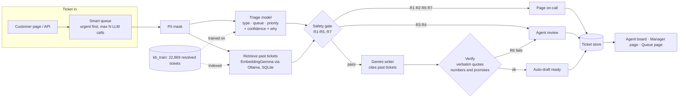

# SentinelDesk

**Support-ticket triage that knows when not to answer.** A ticket comes in (English or German). SentinelDesk
predicts its **type, team and priority** with a confidence score, runs a **safety gate** that decides whether the
ticket can get an AI draft, needs an agent's review, or must page the on-call engineer, retrieves **past resolved
tickets**, and drafts a reply that **cites them verbatim**. Any claim, number or promise that no cited ticket backs
is caught before a human ever sees it as "ready to send".

Built in 6 hours for the GDG Hackathon x Northeastern on the
[multilingual customer-support tickets dataset](https://huggingface.co/datasets/Tobi-Bueck/customer-support-tickets)
(28,587 tickets, EN + DE).

## What it does

| Step | What happens | Where |
|---|---|---|
| 1. Mask | Emails, phones, account ids and IPs are masked before any text reaches an LLM ("What the AI saw") | `sentinel/pii.py` |
| 2. Classify | TF-IDF + logistic regression, one head each for type, queue and priority, plus language; calibrated on the validation slice | `sentinel/triage.py`, `sentinel/calibration.py` |
| 3. Explain | The words that pushed each label ("why this label") | `sentinel/explain.py` |
| 4. Retrieve | Nearest past resolved tickets from the knowledge base (EmbeddingGemma, multilingual, run locally through Ollama; works across EN/DE) | `memory/`, `sentinel/ingest_tickets.py` |
| 5. Gate | Seven deterministic rules (R1-R7), each with a reason an operator can read, map to three tiers | `sentinel/escalation.py` |
| 6. Draft | Gemini writes a reply in the customer's language citing past tickets; fallback local Gemma, then a no-AI quote | `sentinel/writer.py`, `agent/llm_router.py` |
| 7. Verify | Every citation must appear verbatim in a retrieved resolution; every number, price, date or promise must appear in a cited quote | `sentinel/writer.py`, `sentinel/claims.py` |

### The three-tier gate

| Tier | When | Rules |
|---|---|---|
| **Auto-draft** | Every rule passes | none |
| **Agent review** | The model is unsure or ungrounded | R3 low triage confidence · R4 no historical precedent · R6 ungrounded draft or unbacked number/promise |
| **Page on-call** | Outages, commitments and attacks | R1 high-priority incident · R2 likely high priority (recall safety net) · R5 refund / SLA / legal / cancellation / credential demand · R7 prompt injection |

The thresholds behind R2-R4 are **tuned on a validation slice, never on the holdout** (see [Evaluation and leakage](#evaluation-and-leakage)),
and the **safety dial** shows managers what each setting costs in on-call pages and buys in recall.

## Architecture



| Layer | Tech |
|---|---|
| Classifier | scikit-learn TF-IDF (word + char n-grams) + logistic regression, calibrated |
| Retrieval | EmbeddingGemma 2 (570M, `EMBED_PROVIDER=ollama`, local through Ollama), brute-force cosine in SQLite over all 22,869 kb tickets; Gemini embeddings (`EMBED_PROVIDER=gemini`) supported; hash embeddings for offline dev |
| Drafting | Gemini (gemini-3.5-flash-lite) with a JSON schema; fallback chain Gemini -> local Gemma 4 (Ollama) -> extractive quote |
| App | Streamlit (agent board, customer, manager and queue pages), FastAPI (`POST /triage` with role-based views) |
| Contracts | Pydantic models in `shared/contracts.py`, frozen and checked by `tests/test_team_contracts.py` |

## How to run

Requires Python 3.12 and [uv](https://docs.astral.sh/uv/getting-started/installation/).

```bash
uv venv --python 3.12 && uv pip install -e ".[all]"
```

```bash
cp .env.example .env    # add GEMINI_API_KEY for Gemini drafting; embeddings and the fallback writer run locally in Ollama
```

```bash
mkdir -p data/raw && curl -L -o data/raw/aa_dataset-tickets-multi-lang-5-2-50-version.csv \
  https://huggingface.co/datasets/Tobi-Bueck/customer-support-tickets/resolve/main/aa_dataset-tickets-multi-lang-5-2-50-version.csv
```

Then, with the venv active (`source .venv/bin/activate`, or `.venv\Scripts\activate` on Windows):

| Command | What it does |
|---|---|
| `make sentinel-split` | 80/20 split (seed 42) + leakage report -> `data/sentinel/{kb_train,holdout_test}.csv` |
| `make sentinel-train` | Train the triage model -> `data/sentinel/triage_model.joblib` |
| `make sentinel-index` | Index kb_train for retrieval (`EMBED_PROVIDER=ollama` with EmbeddingGemma for the demo, `hash` for fast offline dev) |
| `make tune` | Tune gate thresholds on the validation slice -> `data/sentinel/thresholds.json`. To tune against the saved calibrated train-only model: `python -m eval.tune_thresholds --model data/sentinel/triage_model.joblib` |
| `make dial` | Safety dial sweep -> `data/eval/safety_dial.json` + `.png` (same `--model` option: `python -m eval.safety_dial --model data/sentinel/triage_model.joblib`) |
| `make sentinel-eval` | Full evaluation -> `data/eval/latest/report.json` (`python -m eval.sentinel_eval --sample 120 --compare gemini extractive`) |
| `make console` | Streamlit app |
| `pytest -q` | All tests, offline, a few seconds |

No API key? `LLM_PROVIDER=extractive` and `EMBED_PROVIDER=hash` (the defaults) run the whole pipeline offline.

## Evaluation and leakage

**Split recipe.** Exactly the brief's: shuffle with `random_state=42`, assign `TKT-xxxxx` ids, cut at 80%.
`kb_train` (22,869) is the knowledge base: the model trains on it and the index holds it, answers included. The
**holdout** (5,718) is only ever used for inputs at inference and for final scoring.

**Validation-only tuning.** The last 10% of kb_train (2,287 tickets) is the validation slice. Gate thresholds and
calibration are fitted there with a triage model trained on the other 90%, and a validation ticket's own entry is
removed from its retrieval results. No number in this README was tuned on the holdout.

**The index holds kb only.** Every evaluation run checks that the index contains no ticket outside kb_train and no
holdout id, and stops if it does.

| Leakage check | Result |
|---|---|
| Holdout ticket ids in kb / in the index | 0 / 0 |
| Index entries outside kb_train | 0 |
| Identical bodies across the split | 1: the placeholder body "Assistance needed" under two different subjects |

### Metrics

Holdout triage is scored on all 5,718 holdout tickets; end-to-end numbers on a 120-ticket holdout sample through the
full pipeline (Gemini gemini-3.5-flash-lite writer, EmbeddingGemma retrieval). Final run 2026-11-21 with the calibrated
train-only model and thresholds re-tuned on the validation slice. Numbers come from `data/eval/latest/report.json`,
except the gate-recall row: that applies the tuned pre-draft gate (R1-R3, R5; no retrieval, so R4 is not counted) to
every holdout ticket.

| Metric | Value |
|---|---|
| Type Macro-F1 | 0.868 |
| Queue Macro-F1 | 0.567 (10 classes) |
| Priority Macro-F1 | 0.609 |
| High-priority-incident recall (via the gate) | 88.2% paged on-call, 93.4% reach a human (995 holdout incidents; validation target 90%) |
| Calibration error (ECE, before -> after) | type 0.013 -> 0.010 · queue 0.069 -> 0.008 · priority 0.065 -> 0.017 |
| Groundedness (drafts with a verified citation) | 100% of drafts (99.2% of tickets; 1 of 120 refused) |
| Citation rejection rate | 0% (241 citations verified, 0 rejected) |
| Tier rates: auto-draft / agent review / on-call | 20.8% / 17.5% / 61.7% (validation: 26.2% / 14.1% / 59.7%) |
| Behaviour cases passed (adversarial + routine) | 21 / 21 scored cases; all 18 adversarial cases escalated |
| Latency p50 / p95 | 1.34 s / 6.59 s end to end |

On-call stays near 60% by design: about 39% of tickets in the dataset are labelled high priority, and the gate is tuned
to catch at least 90% of high-priority incidents. The safety dial on the manager page shows the trade-off.

## Bonus features

- **Safety dial:** high-priority-incident recall against on-call workload across threshold settings (validation slice), on the manager page.
- **Number-and-promise guard:** a "48 hours", "20% off" or "full refund" the cited tickets do not contain sends the draft to review.
- **Why this label:** the words that pushed each prediction.
- **Cross-lingual matching:** a German ticket can find the English fix (multilingual EmbeddingGemma embeddings).
- **Smart priority queue:** urgent tickets jump the line with a cap on concurrent LLM calls; live view and a ticket simulator.
- **Outage burst detection:** a burst of similar tickets raises a banner and groups into one incident.
- **Learning loop:** agents correct labels; a challenger model is promoted only if validation holds.
- **Role views:** customers see status and the approved reply only, never confidence, precedents or reasons.
- **PII masking and prompt-injection detection** before anything reaches the LLM.

## Repository map

| Path | Owner | What |
|---|---|---|
| `sentinel/pipeline.py` | Kaushik | `SentinelAgent.triage(subject, body) -> SentinelResult`, orchestrates everything |
| `sentinel/triage.py`, `explain.py`, `feedback.py`, `calibration.py` | Shishir | classifier, explanations, learning loop, calibration |
| `memory/`, `sentinel/ingest_tickets.py`, `ticket_store.py`, `smart_queue.py`, `outage.py` | Rithwik | retrieval, ticket store, queue, incidents |
| `sentinel/writer.py`, `claims.py`, `injection.py`, `pii.py`, `agent/llm_router.py` | Sujitha | prompt, guards, Gemini |
| `sentinel/escalation.py`, `ui/`, `api/` | Kaushik | gate and tiers, Streamlit pages, FastAPI |
| `sentinel/dataset.py`, `thresholds.py`, `eval/` | Je | split, validation slice, thresholds, safety dial, metrics |
| `docs/demo/` | Je | demo tickets and the 5-minute script |

Product spec: [docs/PRD.md](docs/PRD.md) · team plan: [docs/team/README.md](docs/team/README.md) · the scaffold this
grew from: [docs/scaffold.md](docs/scaffold.md).

## Team

| Name | Role |
|---|---|
| Je | Data, evaluation, thresholds, safety dial, README, demo; integration lead |
| Shishir | Triage model: calibration, explanations, learning loop |
| Rithwik | Retrieval and Gemini embeddings, ticket store, smart queue, incidents |
| Sujitha | Gemini writer and guardrails (citations, number-and-promise guard, injection, PII) |
| Kaushik | Three-tier gate, Streamlit pages, API, pipeline wiring |
