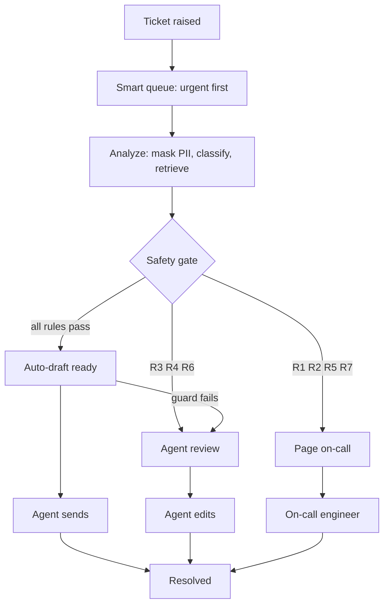

# SentinelDesk PRD (repo copy)

Living version with diagrams: https://claude.ai/artifact/BMBD265SrSBNuACibm4XDt · UI mockup: https://claude.ai/artifact/SgqAzibyxLt9BYVDYECy2w
(both private to Je; ask Je to share). Team plan and owners: docs/team/README.md.

## Summary
A ticket comes in. SentinelDesk predicts type, team (queue) and priority with calibrated confidence, applies a
safety gate, retrieves similar past resolved tickets, and drafts a reply in English or German that cites them.
We build on Shishir's pipeline (already on main) and add the features below.

## What sets us apart
| Feature | What it does | Owner |
|---|---|---|
| Three-tier gate | Auto-draft / Agent review / Page on-call. Only outages, commitment demands and injections page on-call | Kaushik |
| Safety dial | Escalation rate vs high-priority recall across thresholds (validation slice) | Je |
| Why this label | Words that pushed each prediction | Shishir |
| Number and promise guard | Every number/price/date/promise in a draft must appear in a cited quote | Sujitha |
| Smart priority queue | Urgent tickets jump the line, max N LLM calls at once, live view + simulator | Rithwik |
| Role views | Customer, agent, manager pages; customers never see internal fields | Kaushik |
| Learning loop | Agent corrections, challenger model promoted only if validation holds | Shishir |
| Incident grouping (stretch) | Burst -> one incident, one status update for all | Rithwik |

Already in the base: verbatim citation checks, fallback chain (Gemini -> local Gemma -> no-AI quote), leakage report.

## Gate and lifecycle

R1 high-priority incident, R2 likely high priority, R3 low confidence, R4 no precedent, R5 refund/legal/credential
demand, R6 ungrounded or guard-failed draft, R7 prompt injection.

## Requirements
Required (built, being improved): triage + confidence, gate, retrieval, grounded reply, console, holdout eval.
Bonus: cross-lingual matching (needs Gemini embeddings), burst detection (built), PII masking (built).
Fixes: F1 tune thresholds on validation not holdout (Je), F2 calibration (Shishir), F3 dependencies (done on main),
F4 Gemini embedder (Rithwik), F5 Gemini drafting run (Sujitha), F6 README (Je).

## Model plan
Triage: TF-IDF + logistic regression (built), calibrated on the validation slice. Retrieval: Gemini embeddings,
EmbeddingGemma/hash as backups. Drafting: Gemini with JSON schema; fallback local Gemma, then extractive quote.
Split: brief's recipe (seed 42, 80/20); validation = last 10% of kb_train; holdout touched only for final scores.

## UI
Streamlit: agent tickets board grouped by tier + side panel (briefing, verdict, "What the AI saw", three triage
questions with reasons, safety checks, past tickets, cited reply), customer page, manager page (counts, tiers,
safety dial, metrics, Retrain), smart-queue page. All pages share sentinel/ticket_store.py.

## Metrics
Macro-F1 (type, queue, priority) and high-priority-incident recall on the full holdout; groundedness, citation
rejection, tier rates, latency p50/p95 on a 120-ticket sample; behaviour cases; calibration error; leakage report.
Only numbers from the post-F1 run go in the README.

## Demo (5 min)
Problem -> customer raises German ticket with an email -> agent board + panel -> refund trap and injection caught ->
fire 10 tickets, burst banner -> manager page with safety dial and metrics.
